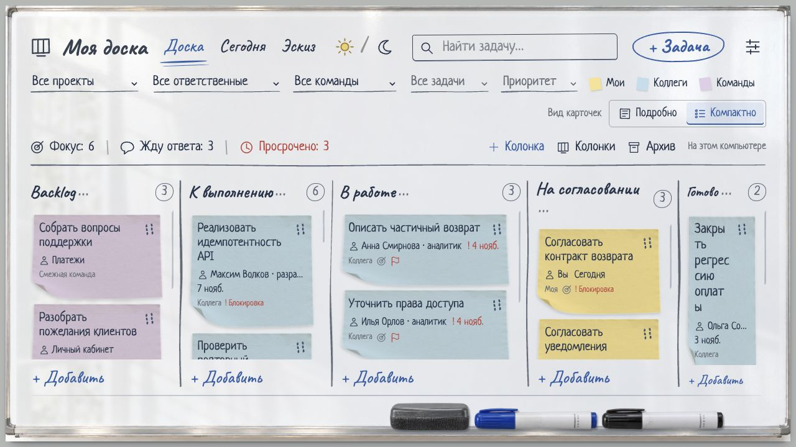
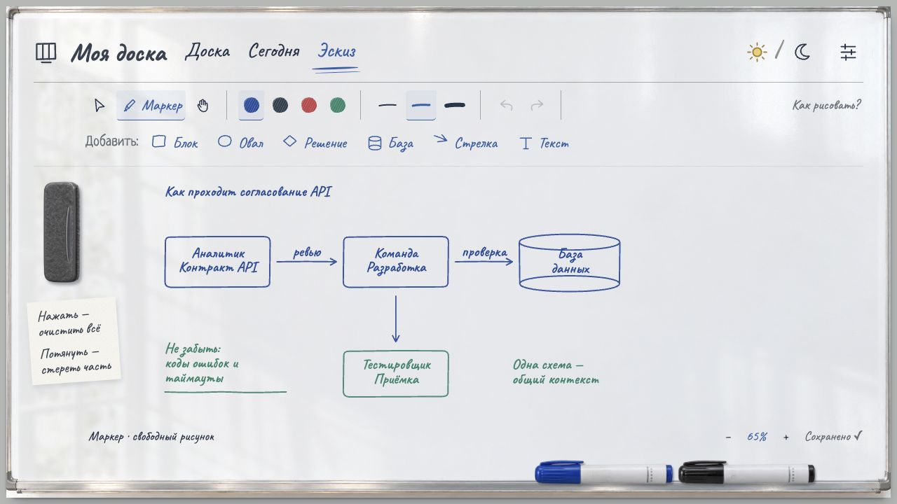
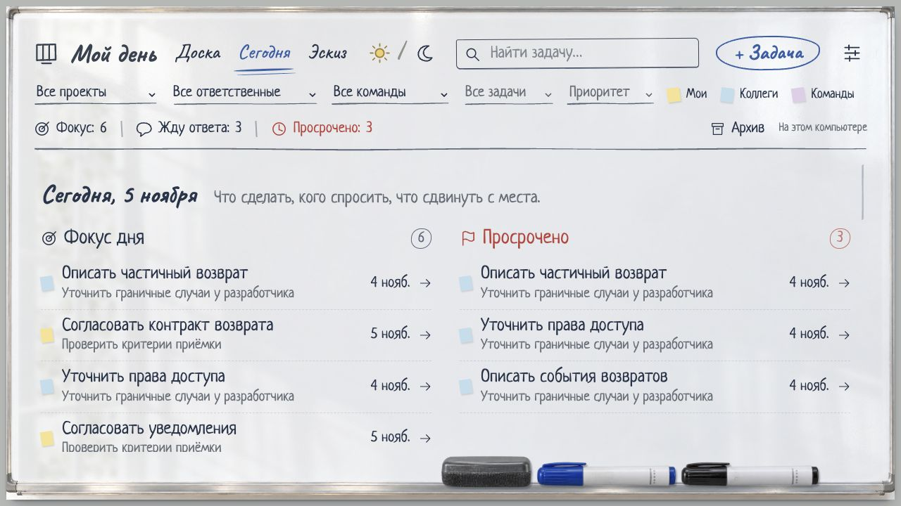
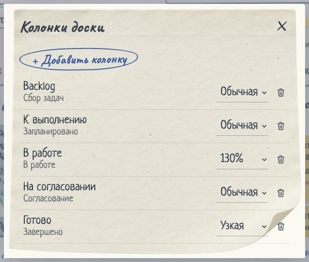
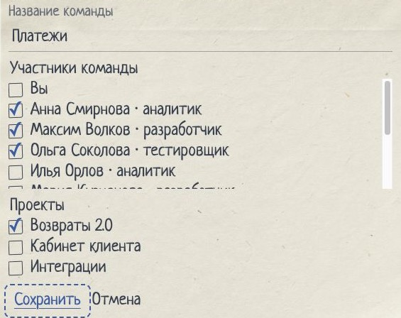
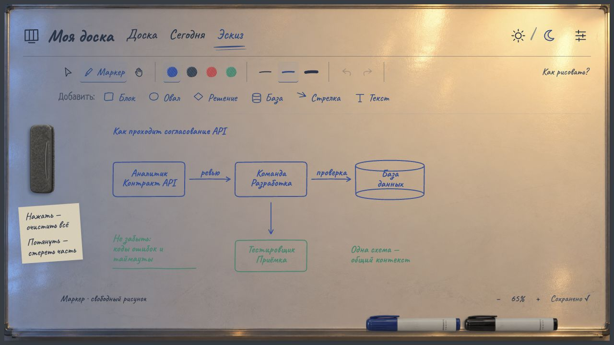
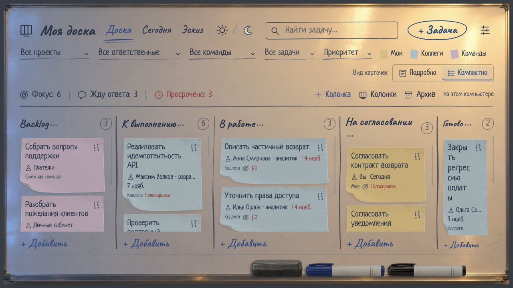
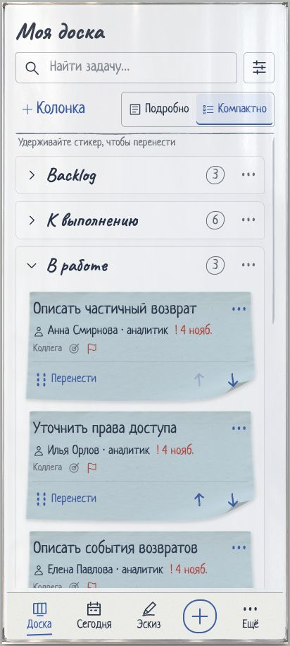
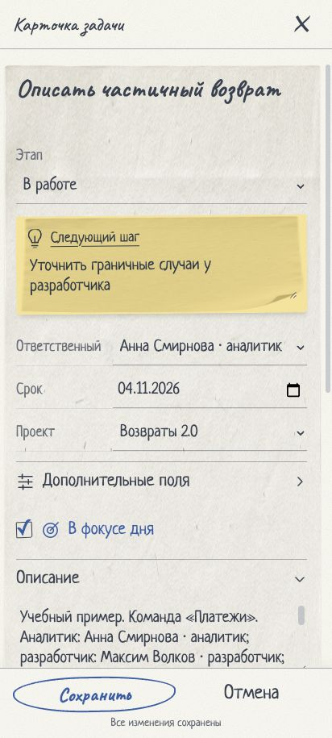

# Моя доска

«Моя доска» — локальная Kanban-доска для системного аналитика. Соберите в одном месте свои задачи, договорённости с коллегами и работу смежных команд. Настройте колонки под свой процесс, откройте «Сегодня», чтобы выбрать фокус дня, или набросайте схему взаимодействия в «Эскизе».

Задачи, связи сотрудников с командами и рисунки хранятся в SQLite на вашем компьютере. Для запуска нужна одна команда — `npm start`.

[Быстрый запуск](#быстрый-запуск) · [Возможности](#что-умеет-доска) · [Эскиз](#эскиз-рядом-с-задачами) · [Руководство](docs/guide.md) · [GitHub](https://github.com/Vadim-Bogdanchik/marker-board) · [GitVerse](https://gitverse.ru/bogdanchik_vadim/marker-board)



*Демонстрационная доска с тремя командами. Для текущей работы отведено больше места, для завершённых задач выбрана узкая колонка. При первом запуске вы получите пустую доску.*

| Доска | Сегодня | Эскиз |
| --- | --- | --- |
| Задачи на стикерах, этапы, зависимости и ожидания. | Фокус дня, сроки и напоминания. | Свободный рисунок, готовые фигуры, стрелки и печатные подписи. |



## Для спокойного рабочего дня

Утром откройте **«Мой день»**, выберите задачи в фокус и проверьте, кому пора напомнить о договорённости. Днём перемещайте стикеры по этапам, фиксируйте следующий шаг и отмечайте зависимости. Вечером завершите сделанное — всё останется на месте к следующему запуску.

Доска помогает видеть не только «что сделать», но и **что мешает продолжить**: незавершённую зависимость, блокировку, ожидание ответа или отсутствие даты следующего контакта.



## Что умеет доска

| Возможность | Как помогает в работе |
| --- | --- |
| **Колонки Kanban** | Добавляйте этапы под свой процесс и меняйте их ширину. При удалении заполненной колонки вы выбираете, куда перенести стикеры. |
| **Свои задачи и задачи коллег** | Цвет и подпись различают личные задачи, задачи коллег и смежных команд. Сотрудник может входить в несколько команд, а команда — участвовать в нескольких проектах. |
| **«Мой день»** | Ручной фокус, просрочки, сроки сегодня и в ближайшие семь дней, наступившие напоминания. |
| **«Эскиз»** | Рисование маркером, готовые блоки и стрелки, печатные подписи рукописным шрифтом. Магнитный стиратель и отмена действий. |
| **Следующий шаг** | Отдельный стикер в карточке подсказывает конкретное действие, с которого начать. |
| **Ожидания и зависимости** | От кого и что получить, когда напомнить себе, что блокирует задачу. Циклы зависимостей запрещены. |
| **Контекст в одной карточке** | Описание, приоритет, срок, проект, ответственный, команда, чек-лист и ссылки. |
| **Быстрый обзор** | Поиск по названию и описанию, совместные фильтры, подробный и компактный вид карточек. |
| **Контроль нагрузки** | Настраиваемый лимит своих задач в работе и время с первого перехода в работу или согласование. |
| **Архив и резервные копии** | Архивирование с восстановлением, экспорт и импорт JSON, копия SQLite перед миграциями. |

### Колонки и команды

Кнопка **«+ Колонка»** добавляет этап. Потяните разделитель, чтобы освободить место для длинных названий задач, или выберите ширину в меню **«Колонки»**. Нажмите **«…»** в заголовке, чтобы переименовать или удалить колонку.

В **Настройках → Люди, команды и проекты → Команды** откройте команду карандашом, отметьте её участников и проекты. Теперь при выборе команды в карточке задачи связанные сотрудники и проекты появятся первыми в списках.

| Настройка колонок | Участники и проекты команды |
| --- | --- |
|  |  |

## Эскиз рядом с задачами

Откройте **«Эскиз»**, чтобы набросать процесс, схему взаимодействия или идею. Маркер рисует свободно; панель добавляет блок, овал, решение, базу данных, стрелку и текст. Названия можно печатать с клавиатуры — они остаются редактируемыми и выглядят написанными маркером.

Слева примагничен стиратель: **нажатие очищает рисунок**, **перетаскивание стирает только пройденный участок**, а после отпускания губка возвращается на место. Очистку и стирание можно отменить. Эскиз автоматически сохраняется в SQLite и включается в резервную копию доски.

- **Рисуйте свободно:** четыре цвета маркера и три толщины; незамкнутые линии сохраняются как нарисованы.
- **Собирайте схему из фигур:** блок, овал, решение, база данных, стрелка и отдельный текст.
- **Печатайте подписи:** поле ввода открывается рядом с элементом. Названия блоков и стрелок можно менять позже.
- **Правьте расположение:** выбор и рука перемещают элементы; угловая ручка меняет размер. Корзинка рядом с выделением удаляет элемент.
- **Управляйте холстом:** начальный масштаб 100%, увеличение, уменьшение и вписывание схемы. Отмена и повтор помогают исправить действие.

| Эскиз днём | Эскиз вечером |
| --- | --- |
|  |  |

*На снимках схема вписана в видимую область кнопкой масштаба. Это интерактивный холст работающего приложения, а не дизайн-рендер.*

## Одна доска — два освещения

Днём — светлая эмаль и едва заметное отражение окна с движущейся листвой. Вечером — та же доска в тёплом свете лампы. Бумага сохраняет фактуру, края и тени, а надписи остаются настоящим текстом: их можно редактировать и искать.

| День | Вечер |
| --- | --- |
|  |  |

Отражение можно полностью отключить. Системное предпочтение уменьшенного движения отключает анимации. Шрифты с кириллицей и все графические материалы поставляются вместе с приложением.

## Удобно и на узком экране

На компьютере — колонки настраиваемой ширины и перетаскивание стикеров. На узком экране — вертикальный список сворачиваемых этапов, нижняя навигация и полноэкранный редактор.

| Мобильная доска | Карточка задачи |
| --- | --- |
|  |  |

- Тяните за **«Перенести»** или удержите текст стикера, чтобы переместить его пальцем.
- Кнопки **↑ / ↓** меняют порядок; меню **⋯** позволяет выбрать этап без перетаскивания.
- **Подробно / Компактно** переключает плотность карточек. Выбор запоминается отдельно для широкого и узкого экрана.
- На десктопе перенос доступен с клавиатуры: **пробел → стрелки → пробел**, **Escape** отменяет действие.

Мобильный интерфейс проверен в браузерной эмуляции, в том числе Pixel 7. Физические iOS/Android-устройства ещё требуют проверки. Текущая версия слушает только localhost: чтобы открыть её на другом устройстве по сети, потребуется отдельная доработка доступа.

## Быстрый запуск

Понадобятся **актуальный Node.js 24 LTS и npm** (на дату аудита 31.10.2026 — не ниже 24.22.1). Отдельный сервер базы данных и Docker не нужны.

Скачайте ZIP репозитория и распакуйте его либо клонируйте проект:

```sh
git clone https://github.com/Vadim-Bogdanchik/marker-board.git
cd marker-board
npm start
```

Можно использовать GitVerse вместо GitHub:

```sh
git clone https://gitverse.ru/bogdanchik_vadim/marker-board.git
cd marker-board
npm start
```

`npm start` установит зависимости по lock-файлу, подготовит SQLite, применит миграции, соберёт приложение и откроет **http://localhost:3000**. Оставьте терминал открытым; **Ctrl+C** завершает работу. Для следующего запуска нужна та же команда.

| Система | Файл запуска |
| --- | --- |
| macOS | Двойной щелчок по `start.command` |
| Linux | `bash start.sh` |
| Windows | Двойной щелчок по `start.bat` |

Первый запуск требует интернета для загрузки npm-пакетов. После установки приложение работает автономно. При обновлении зависимостей интернет может понадобиться снова. Запуск проверен на macOS; файлы для Windows и Linux подготовлены, проверка на этих ОС ещё предстоит.

## Ваши данные остаются у вас

Задачи, эскиз и настройки доски хранятся в **`.local/board.sqlite`**. Локальные базы, резервные копии, зависимости и файлы окружения исключены из Git. Учётные записи коллег и подключение к внешнему сервису для работы не нужны.

Для переноса между компьютерами используйте экспорт JSON в настройках. Для полной копии базы:

```sh
npm run backup
```

Подробности: [хранение данных и восстановление](docs/guide.md#где-находятся-данные). Не удаляйте `.local` при обновлении приложения.

## Разработка

**React + TypeScript + Vite** — интерфейс. **Node.js + Fastify** — локальный API. **SQLite + Drizzle ORM** — хранение и миграции. **Zod** — проверка данных, **dnd-kit** — перетаскивание.

```sh
npm test                 # Правила, зависимости, даты, перемещения
npm run test:integration # Реальные SQLite и API во временных папках
npm run build           # Проверка TypeScript и production-сборка
npm run qa              # Отдельная тестовая доска на localhost:3100
```

Тесты проверяют связи справочников, изменение состава и ширины колонок, порядок карточек, циклы зависимостей, импорт, сохранность данных, обработку кадров рисования, защиту API и откат неудачных операций.

Замеры и оптимизация рисования описаны в [отчёте о производительности](docs/performance.md). Отдельный нагрузочный стенд: `npm run perf:sketch` (тестовая база, порт 3101).

- [Подробное руководство](docs/guide.md)
- [Как предложить изменение](CONTRIBUTING.md)
- [Проверка мобильного интерфейса](docs/mobile-ui-2026-10-31.md)
- [Отчёт о функциональности и UX/UI](docs/qa-2026-10-31.md)
- [Безопасность локальной версии](SECURITY.md) и [отчёт аудита](docs/security-audit.md)

## Текущая версия

Это **локальный MVP для одного владельца**. Совместного редактирования, авторизации, серверной Docker-поставки, фоновых уведомлений и внешних интеграций пока нет. Напоминания доступны внутри открытого приложения.

Проект развивается как личный инструмент с открытым исходным кодом. Идеи, сообщения об ошибках и улучшения интерфейса приветствуются.

## Лицензия и материалы

Исходный код распространяется по [MIT License](LICENSE). Шрифты **Caveat** и **Neucha** имеют собственные лицензии [SIL Open Font License](public/licenses/). Фотореалистичные текстуры созданы с помощью генерации изображений; запросы и описание материалов сохранены в `docs/`. Дизайн-концепты в `output/design/` — иллюстрации, а изображения в этом README — скриншоты реализованного приложения.
