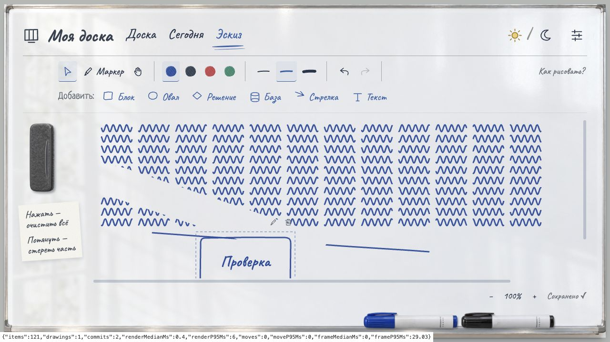

# Проверка производительности — 31 октября 2026

Задержка рисования воспроизведена на отдельной локальной базе с 120 штрихами и 48 000 точками. Основная пользовательская база не использовалась для нагрузочных изменений.

| Сигнал | До | После | Условия |
|---|---:|---:|---|
| Медиана времени обновления React, медиана трёх прогонов | 42,4 мс | 0,5 мс | От начала SketchBoard до layout effect после commit |
| Диапазон медиан обновления в трёх прогонах | 40,7–47,9 мс | 0,5–0,8 мс | Один одинаковый штрих за прогон |
| Вызовы отрисовки элементов за жест | 1210–1452 | 9 | 120 существующих штрихов + новый |
| Медиана интервала кадров, медиана трёх прогонов | 34 мс | 16,7 мс | requestAnimationFrame во время жеста |
| p95 интервала кадров, медиана трёх прогонов | 66,8 мс | 49,8 мс | Короткие прогоны, влияние фоновой нагрузки |
| SVG-элементы эскиза до первого открытия вкладки | 120 | 0 | Отложенное создание холста |

Это лабораторные измерения текущего компьютера, не INP/CrUX и не гарантия FPS. Использован встроенный браузер Codex, окно 1280×720, production-сборка, дневная тема с включённым отражением, масштаб 100%, localhost, без искусственного ограничения CPU или сети, прогретая страница. Три одинаковых перетаскивания от (280, 520) до (980, 550), по 8 pointermove; между ними отмена, чтобы каждый раз начинать с 120 штрихов. Исходные числа — [performance-sketch.json](performance-sketch.json). Полноценный DevTools trace недоступен в текущем инструменте; использованы локальные счётчики React и времени кадров.

В момент диагностики были активны и другие процессы: Storage около 81% CPU, WindowServer около 46%, Blender около 37%. Это показатели отдельных процессов в одном снимке, не процент загрузки всего ноутбука. Чужие процессы не останавливались. Фоновая нагрузка ограничивает точность сравнения времени; сокращение числа повторных отрисовок подтверждает устранение лишней работы независимо от неё.

## Что изменено

- `SketchElement` выделен в самостоятельный мемоизированный компонент. Готовые элементы и их SVG-пути сохраняются при изменении соседнего штриха. Подпись, цвет, выделение, перемещение и маски стирания по-прежнему обновляются по изменению соответствующего объекта.
- `SketchDrawing` также мемоизирован: переключение инструмента не пересчитывает геометрию каждого штриха.
- `useSketch` сериализует сохранённые элементы только при изменении массива. Ранее сериализация выполнялась на каждом кадре и повторно внутри аргумента `useRef`, несмотря на то, что React игнорировал новое начальное значение.
- Размер холста вычисляется по изменению документа, а не по каждому движению. Границы штриха считаются одним проходом без временных массивов координат.
- `frameScheduler` объединяет визуальные обновления в один кадр. Образцы указателя не отбрасываются: в модели жеста сохраняются все поступившие точки. При завершении, отмене и размонтировании отложенный кадр отменяется; итог берётся из актуального previewRef.
- Координаты coalesced events используют одно чтение положения холста на событие вместо повторных DOM-измерений каждой точки.
- Эскиз создаётся при первом открытии вкладки, затем остаётся смонтированным для сохранения истории, масштаба и черновика. Мемоизация защищает скрытый холст от несвязанных обновлений интерфейса задач.

## Проверка остального приложения

Просмотрены App, настольная и мобильная доски, алгоритмы перемещения, редактор задач, настройки, модель зависимостей и ежедневного обзора, API, SQLite-хранилище, миграции, сценарий запуска, отражение и материалы.

Сохранение эскиза уже использует отдельную таблицу/ревизию и debounce; сетевой запрос не выполняется на каждом движении. Транзакции, проверка конфликтов и откат ошибок сохранены. Отражение учитывает скрытую вкладку и prefers-reduced-motion; его внешний вид в этом изменении не упрощался.

Кандидаты для отдельного измерения при росте объёма данных:

- Чтение задач собирает зависимости/чек-листы повторными `filter`, а `GET /api/sketch` читает всю доску. При больших досках стоит измерить эти запросы и заменить сборку на индексы и отдельное чтение эскиза.
- Операции над задачами пока транзакционно перезаписывают таблицы доски. Дифференциальная запись может ускорить большие доски, но требует отдельной проверки порядка, импорта и конкурентных ревизий.
- Очень длинные штрихи и большое число масок требуют построения сложных SVG-путей. Если это станет следующим узким местом, нужны отдельные замеры длинного активного штриха и GPU-композиции отражения.

Эти пункты — выводы статического просмотра, не измеренные причины текущей задержки. Они не включены в рискованную замену хранения или движка рисования.

## Проверки

- 23 модульных и 6 интеграционных тестов прошли; TypeScript и production-сборка прошли.
- Новые проверки: 100 накопленных образцов публикуются одним кадром без потери точек; отменённый кадр не появляется после завершения жеста, undo или следующего жеста.
- В браузере: открытые штрихи, undo, изменение размера, перенос рукой, частичное стирание, новая фигура, печатная подпись и Enter, сохранение, переключение вкладок. Все SVG-пути и маски до/после перезагрузки совпали. Ошибок в консоли не обнаружено.

## Повторение замера

Запустите `npm run perf:sketch`, затем откройте `http://localhost:3101/?sketchPerf=1` и вкладку «Эскиз». Создаётся отдельная новая база внутри `.local/performance`, основная доска не меняется. Нижняя диагностическая строка показывает результат последнего жеста. Ctrl+C останавливает стенд.

Счётчики включаются только параметром `sketchPerf=1`, не отправляют телеметрию и не запускают диагностический цикл кадров в обычном режиме.

