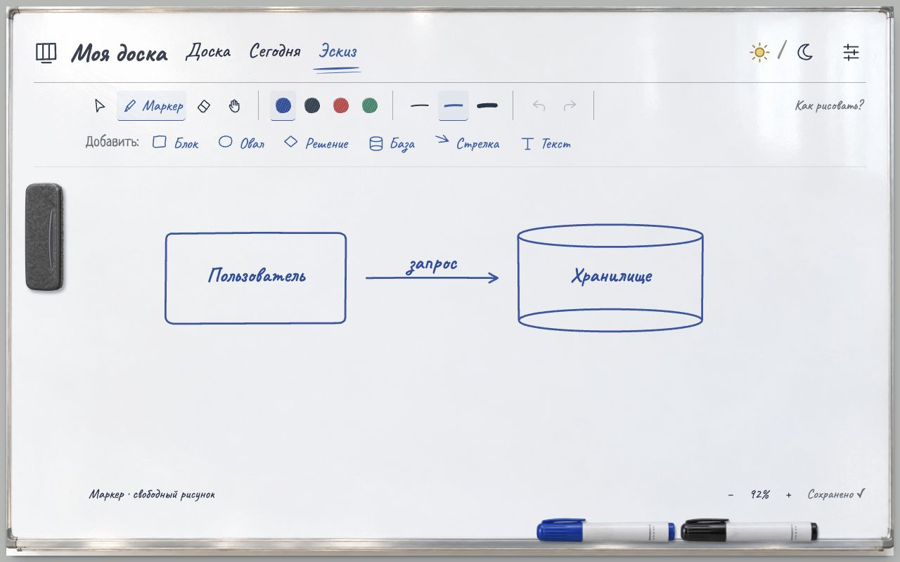
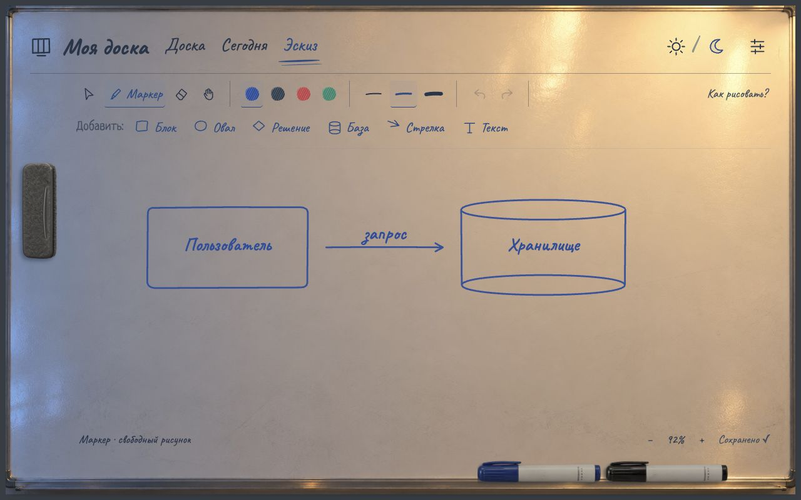
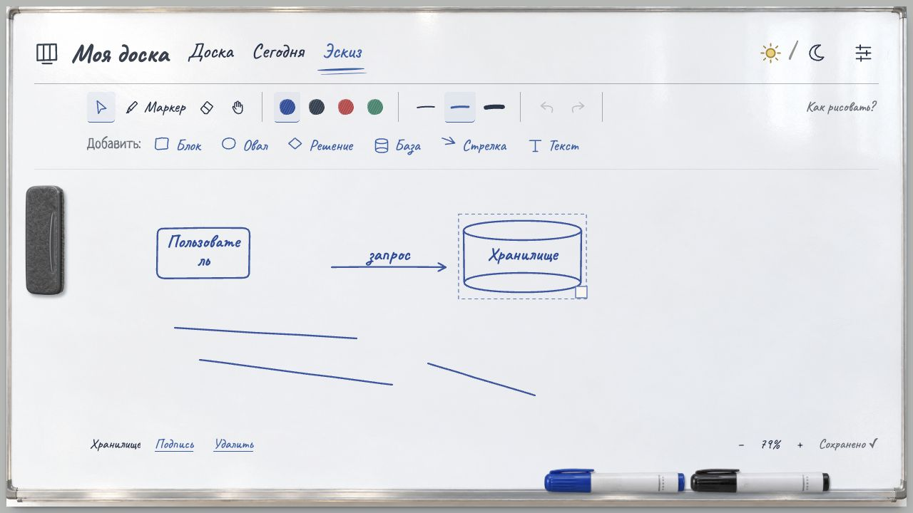
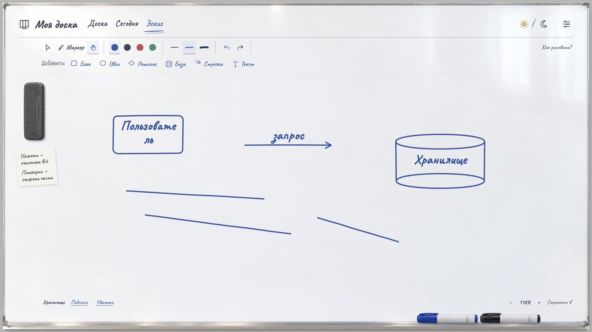
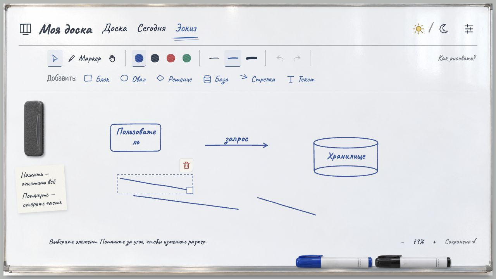
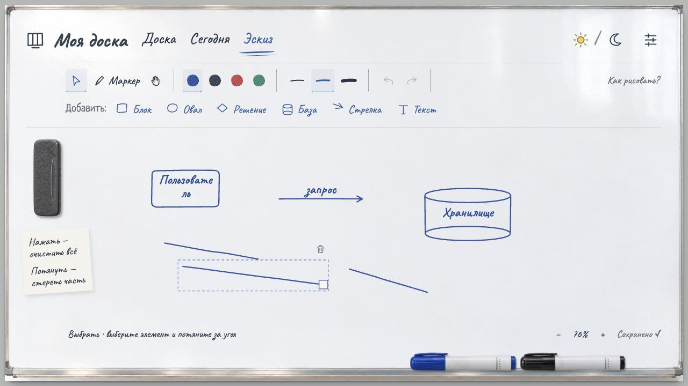
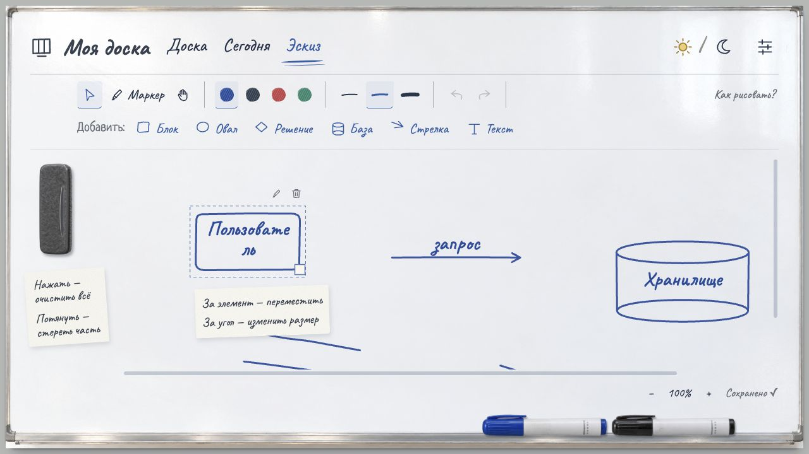
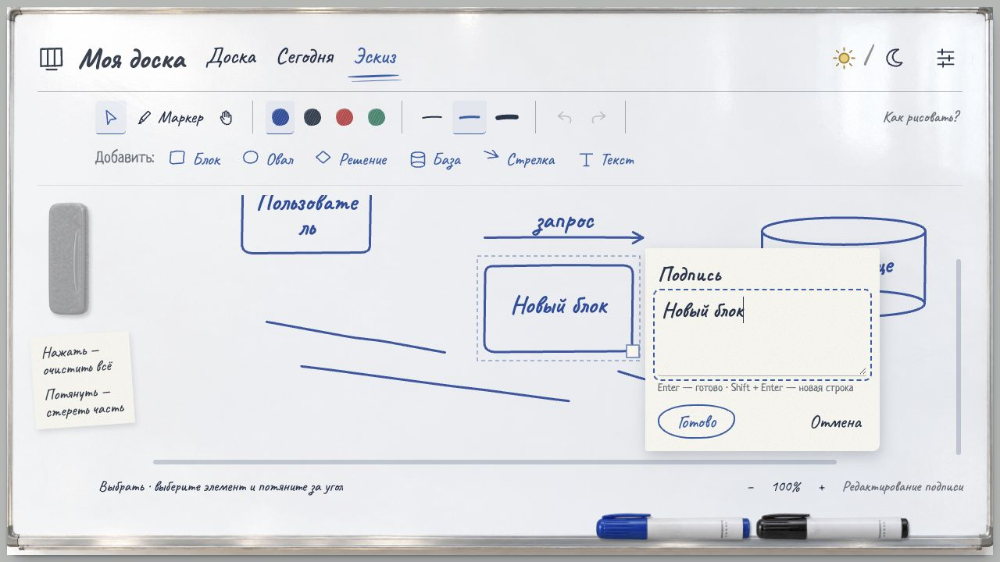

# Эскиз — реализация и проверка

## Интерфейс

Реализован по согласованным концептам `output/design/sketch-concepts/`: та же эмаль, металлическая рамка, дневное/вечернее освещение, рукописные инструменты, отдельный магнитный стиратель слева. Готовые фигуры и подписи — интерактивные SVG-элементы, не изображение интерфейса. Линии сглаживаются; частичное стирание использует маски, через которые виден исходный материал доски. Положение маски сохраняется вместе с элементом.

Стиратель — локальный WebP с прозрачностью, сгенерированный инструментом `image_gen.imagegen` на основе дневного концепта. Сохранён как `public/materials/sketch-eraser.webp`. Запрос: извлечь только вертикальный магнитный стиратель слева, фотореалистичный тёмно-серый войлок, тонкая пластиковая окантовка и углублённый захват, фронтальный вид с небольшой видимой толщиной; прозрачный фон, без доски, курсора и окружающей тени, пропорции примерно 1:2.6. Тени и подъём при наведении добавляются интерфейсом. Курсор руки — локальный SVG; курсор маркера меняет цвет наконечника.

## Данные

Миграция `002_sketch.sql` добавляет таблицу `sketches`; прежние таблицы и идентификаторы задач сохраняются. Существующая база автоматически копируется перед миграцией. Рисунок сохраняется отдельным запросом и ревизией, поэтому параллельное сохранение задач не стирает эскиз. Импорт увеличивает ревизию рисунка, отклоняя запросы из старых редакторов. Формат JSON 2 включает эскиз; формат 1 принимается с пустым эскизом при отсутствии поля.

## Проверка

- `npm test`: 23 модульных теста.
- `npm run test:integration`: 6 интеграционных тестов с реальной SQLite.
- `npm run build`: TypeScript и production-сборка прошли.
- Дополнительные проверки: невалидные/повторные элементы, стирание без мутации истории, перемещение масок, старые резервные копии, независимые ревизии, конфликт вкладок, ошибка SQL с откатом, экспорт/импорт и повторный запуск.
- Проверено обновление исходной SQLite-схемы: задачи сохранились, создан пустой эскиз и резервная копия.
- В браузере на отдельной QA-базе проверены блок, стрелка и база с печатными подписями, рисование, частичное стирание, очистка/отмена, двойное нажатие для редактирования, удаление с клавиатуры и сохранение после перезагрузки.
- На узком экране проверены размещение панели, крупный начальный масштаб, бумажное поле подписи, перемещение холста. Это браузерная проверка с указателем; физические сенсорные устройства и перо отдельно не проверены.

Основная доска обновлена и запущена на localhost:3000. Состояние до и после миграции сравнено программно: 24 задачи, справочники, порядок и настройки полностью совпадают; добавлен только пустой эскиз.

## Границы

Один эскиз на доску. История отмены хранит до 30 действий в текущем сеансе, рисунок — в SQLite. Стрелки являются самостоятельными элементами: автоматическая привязка концов к перемещаемым блокам пока отсутствует. Шаблоны — отдельные типовые фигуры, не BPMN/UML-редактор. Ограничения объёма проверяются на клиенте и сервере.

## Исправление завершения жестов

Потеря SVG pointer capture больше не вызывает отмену действия. Движение и отпускание активного указателя отслеживаются на окне; при pointercancel/потере фокуса сохраняется последний видимый результат. Escape по-прежнему явно отменяет жест. Открытые штрихи не замыкаются автоматически.

Зона захвата угла увеличена до 32 экранных пикселей; видимая ручка — 16 пикселей. Изменение размера считается относительно точки нажатия, поэтому захват края ручки не вызывает скачка. Проверено уменьшение подписанной базы, несколько отдельных открытых штрихов и сохранение результата после reload. Добавлены два теста жизненного цикла указателя: потеря capture, чужой pointerId, повторный pointerup, прерывание и очистка слушателей. Проверка TypeScript/сборка и 19 модульных тестов проходят.

## Рука, подсказка и размер стирателя

«Рука» теперь переносит элементы по той же модели координат, что и выбор; на пустом холсте сохраняется панорамирование. Кнопка ластика и её горячая клавиша удалены. Бумажная подсказка под магнитным стирателем постоянно видима, для неё оставлена отдельная полоса слева.

На десктопе ширина вертикального стирателя ограничена диапазоном 56–84 CSS px и зависит от ширины окна. При захвате фиксируются его фактические размеры: перенос поворачивает губку, но не уменьшает её. Область стирания рассчитывается из этого размера и масштаба холста. Лимит размера маски увеличен до 512 единиц для работы при уменьшенном масштабе; старые маски сохраняют прежние пропорции.

Проверка в браузере: рука перенесла подписанную базу; ластика в панели нет; подсказка видна без наведения. При ширине окна 1745 CSS px измерения стирателя на магните и в переносе совпали: 83.99 × 218.39 px; матрица переноса содержит поворот на 90°, без уменьшения. Частичное стирание и отмена прошли, ошибок в консоли нет. 19 модульных и 6 интеграционных тестов, включая сохранение маски размером 357 единиц, прошли. Основная доска запущена; состояние полностью совпало с резервной копией перед запуском.

## Размер штрихов и действия рядом с выделением

Ручка изменения размера доступна свободным штрихам маркера. Масштабируются точки рисунка и маски стёртых участков, верхний левый угол сохраняет положение. Горизонтальные и вертикальные линии сохраняют нулевую высоту/ширину. Два новых модульных теста проверяют масштабирование, обратное преобразование и отсутствие мутации исходного рисунка; интеграционные тесты проверяют сохранение масштаба маски через API и экспорт.

Удаление перенесено из нижней строки в небольшую корзинку над правым верхним углом выделения. Подсказка — «Удалить элемент». Корзинка видна только в режиме «Выбрать», серая без подложки и краснеет при наведении. Отступ над рамкой — 6 экранных пикселей, размер значка — 18 пикселей; положение рассчитано от той же рамки, поэтому масштаб холста не вызывает наложения. Для фигур рядом расположен карандаш редактирования подписи. Кнопки имеют постоянный экранный размер при масштабировании холста.

В браузере проверены уменьшение и растягивание штриха, удаление корзинкой, отмена через ⌘ Z, открытие подписи карандашом и сохранение размера после обновления страницы. Ошибок в консоли нет. 21 модульный и 6 интеграционных тестов, TypeScript и production-сборка прошли.

Уточнение оформления: в браузере проверены отсутствие корзинки в режиме «Рука», серый цвет и прозрачный фон в режиме выбора, подсказка, выравнивание при масштабе 109% (отступ 6 px, правые края совпадают). TypeScript и production-сборка прошли.

## Начальный масштаб и стикер-подсказка

Начальный масштаб — 100%, автоматическая подгонка при изменении окна удалена. Вписывание доступно явным нажатием на процент. Под выделением в режиме «Выбрать» появляется бумажный стикер с подсказкой перемещения и изменения размера; его шрифт и размеры постоянны в экранных пикселях. Он не перехватывает указатель и исчезает при смене инструмента и редактировании подписи. Нижняя строка не дублирует подсказку выбранного элемента.

В браузере проверены начальные 100%, появление стикера под блоком, сохранение читаемости при 85% и исчезновение в режиме «Рука». TypeScript и production-сборка прошли.

## Подпись рядом с элементом

Бумажное поле ввода привязано к границам редактируемого элемента с учётом масштаба и прокрутки. Обычно расположено справа с отступом 16 px; при нехватке места — слева. Положение ограничено видимой областью, фактическая высота формы отслеживается ResizeObserver. Поле получает фокус без автоматической прокрутки страницы.

В браузере проверены редактирование блока, размещение слева от базы у правого края, прокрутка с открытой формой, добавление нового блока и сохранение названия через Enter. Ошибок в консоли нет; TypeScript и production-сборка прошли.

## Удаление подсказки выделения

По результатам использования бумажный стикер под выбранным элементом удалён вместе с его стилями и дополнительным пространством холста. Подсказка магнитного стирателя сохранена. Начальный масштаб остаётся 100%, окно ввода подписи по-прежнему открывается рядом с элементом.

## Производительность

Готовые элементы выделены в мемоизированные компоненты, промежуточные кадры объединяются, сериализация и расчёт размеров вынесены из обработки каждого движения. Холст впервые создаётся при открытии «Эскиза». Замеры до/после и результаты общей проверки кода — в [отчёте о производительности](performance.md).
